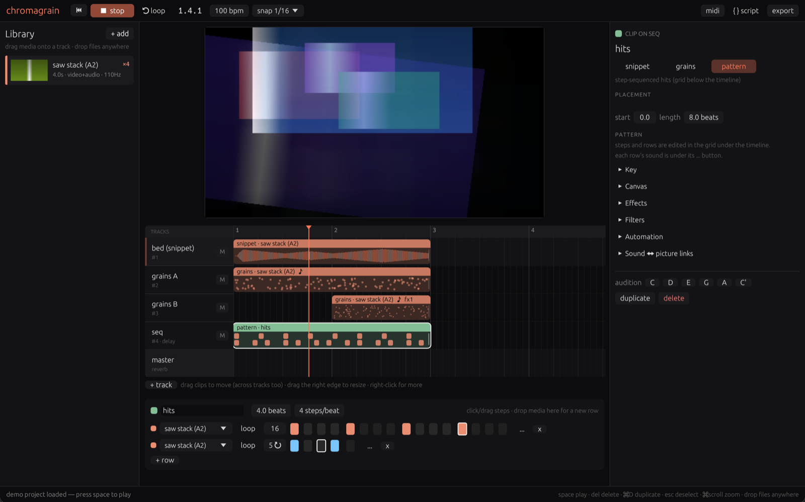
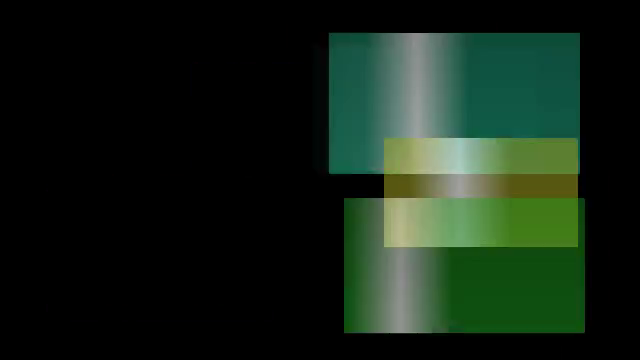
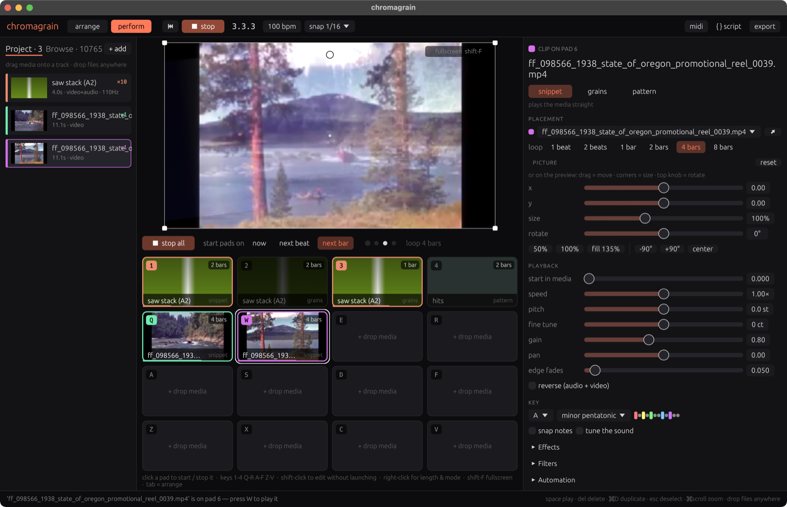
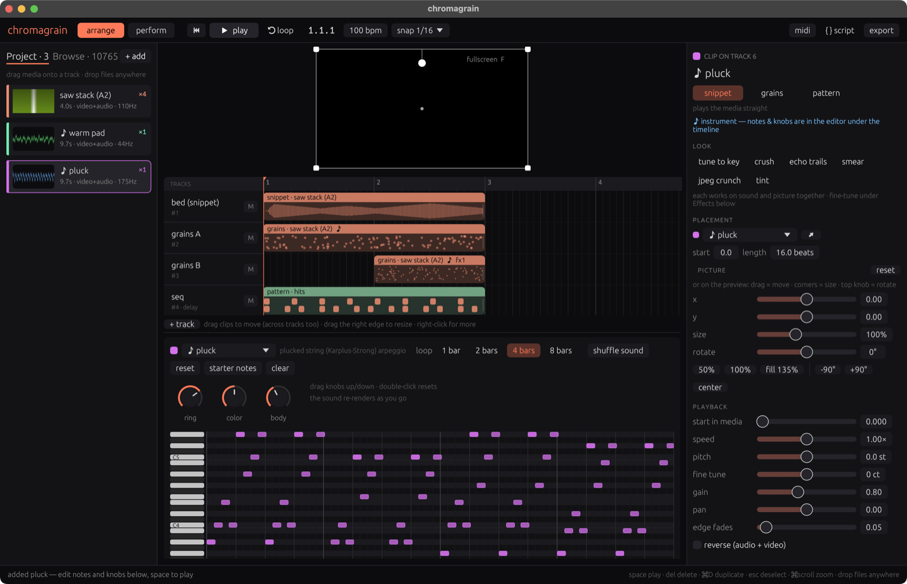

# chromagrain

A native audiovisual sampling & effects compositor / sequencer where **audio
and visual effects correspond** — built in Rust with rhai scripting.



The core idea: **granular synthesis is a first-class citizen, and every audio
grain IS a visual grain.** One scheduler emits grain events; the audio
renderer and the video compositor both consume the *same* events:

| grain field   | what you hear            | what you see                     |
|---------------|--------------------------|----------------------------------|
| onset / dur   | when the grain sounds    | when the patch appears           |
| envelope      | amplitude window         | opacity window                   |
| pitch ratio   | resampling / transposition | patch playback rate + hue rotation |
| pan           | stereo position          | horizontal position on canvas    |
| source pos    | waveform read position   | video read position              |
| reverse       | backwards audio          | backwards video                  |

So a cloud of high, short, wide-panned grains *sounds* sparkly and *looks*
like small, hue-shifted, scattered patches — automatically. **The
correspondence itself is configurable**: every mapping is a dial on the
clip's AV link (0 = unlinked, 1 = fully linked, full correspondence is the
default), so you can, say, keep pitch→hue but let opacity ignore gain.

Clips come in two kinds: **grain clips** (clouds) and **snippets** — media
placed straight on the timeline. A snippet is rendered as ONE long grain, so
the same correspondence applies: its gain is its loudness *and* its opacity.



## AV effects — the crunch you hear is the crunch you see

Effect chains run per clip and on the master bus, and every effect processes
BOTH domains with the same idea:

| effect   | audio                            | video                              |
|----------|----------------------------------|------------------------------------|
| crush    | sample-rate decimation + bit depth reduction | pixelation + color posterize |
| delay    | feedback delay line              | ghost frames at the same delay/feedback, with optional drift |
| reverb   | Freeverb-style combs/allpasses   | frame persistence + blur smear     |
| compress | FFT spectral quantization (codec crunch) | JPEG-style 8×8 DCT block quantization — the same transform-domain math |
| tint     | resonant bandpass narrowing toward the hue's frequency | every hue smushed toward the target color — same axis |

Each effect has independent `audio` and `video` amount dials — that's the
per-effect correspondence control (video 0 = audio-only effect, and vice
versa). It will be crunchy.

## Sequencing & performance

- **Step sequencer** (Koala / Nanoloop energy): patterns of rows, each row
  a sampler pad (source + hit preset + key), each step a beat-quantized
  trigger with optional per-step pitch/gain. Patterns sit ON the timeline
  as pattern clips and loop to fill them — the tool stays timeline-first,
  with the sequencer panel editing whatever pattern clip is selected.
  Every row has its **own step count** (a 5-step row against a 16-step
  grid phases against it — polymeter, drawn in blue), and rows can flip
  into **loop mode**: not sequenced at all, just repeating a start..stop
  slice of their source.
- **Automation**: drag across a strip to draw a curve on any grain
  parameter of a clip (density, pitch, position, gain, pan, spray, scan
  speed…), evaluated per grain so clouds morph as they play. Tracks get a
  drawable level curve that fades audio gain and video opacity together
  (through the same unlinkable correspondence dial).
- **Performance playback**: play is live — a streaming engine renders the
  project in blocks (verified sample-identical to the offline render) into
  the audio device while a **GPU shader pipeline** (grain quads, effect
  passes, track compositing) draws the video in real time. Loop a region,
  tweak grains/effects/steps mid-playback, hear and see it immediately.
- **Track mixer**: every track has its own AV effect chain ("this whole
  track has a lot of delay"), a level fader that ducks audio gain AND
  video opacity (unlinkable, like everything else), mute, and reorder —
  track order is the video compositing z-order.
- **Render button**: the deterministic CPU renderer bounces the
  arrangement to mp4/wav for output; the GPU path is for performing.

## Features

- **Granular engine** (sampler first, and the deepest part of the tool) —
  density, duration ± jitter, spray, scan speed, pitch ± jitter, per-grain
  reverse, deterministic seeds (same seed = same cloud). Grains resample
  with 4-point Hermite interpolation; the grain window has a **skew**
  morphing percussive → symmetric → swell (and the visual grain's opacity
  follows the same shape); onsets can **beat-sync** to a 1/32–1/4 grid for
  rhythmic clouds; and each grain can stack up to 4 **harmony voices** at
  a chosen interval (octaves, fifths…), key-quantized, detuned and spread.
- **SuperCollider instruments, inside the app** — grain cloud, cassette
  keys, prepared string, fold bass, acid fuzz, gamelan metal, formant sync
  lead, speak & spell choir, tape drone and a drum kit, written as
  SuperCollider SynthDefs in Rust (`crates/core/src/sc_defs.rs`) and run
  in-process by [plyphon](https://github.com/nannou-org/plyphon), a
  pure-Rust scsynth. No SuperCollider install, not even to build. No server to launch, nothing routed: each part renders
  into a library source (with an oscilloscope trace as its picture), so it
  gets everything samples get — grains, snippets, patterns, pads, key
  quantize, the AV effect chain and export. See *Instruments* below.
- **Tint (spectral smush)** — a fifth AV effect: smush every hue toward a
  target color while a narrowing resonant bandpass smushes the audio
  spectrum toward the corresponding frequency on the same hue↔freq axis.
  "Make it all reddish" makes it all rumble.
- **Speed and pitch are separate** — a snippet's `speed` changes tempo
  without touching pitch (granular time-stretch under the hood; video
  crossfades along at the same rate), while `pitch` transposes without
  changing tempo. Set them to match and it collapses to a pristine
  record-player resample automatically.
- **Canvas placement** — every clip's video can be positioned, scaled and
  rotated on the canvas. Placement is audible: x drives pan, y drives a
  brightness tilt (up = airy, down = heavy — the elevation cue), and
  scale drives loudness (the distance cue), each through its own
  unlinkable correspondence dial.
- **MIDI** — play any clip like a pad instrument (sampler mapping, C4 =
  unity, velocity → gain, live in audio AND video, transport running or
  not), and map hardware CCs to any automatable parameter or track level
  with MIDI-learn. On-screen pads work without hardware.
- **Key quantization** — every grain's pitch is snapped so
  `base_pitch × ratio` lands on a chosen key/scale (major, minor, harmonic
  minor, pentatonics, blues, modes, whole-tone…). Source base pitch is
  auto-detected via autocorrelation on import (and overridable per source).
  **Key strength** dials the snap from hard (1) through partial pull (0.5)
  to free (0), and a **detune** control shifts everything a few cents off
  AFTER the snap — perfectly in key, subtly off pitch. Both apply to AV
  samples, snippets, synths and sequencer rows alike, and both are
  automatable.
- **AV paulstretch** — derive a spectral wash from any source: overlapping
  FFT frames keep their magnitudes but get randomized phases, so time
  dissolves (2×–64×) while pitch stays put — key quantize still works on
  the wash. The video stretches by the same factor with neighbor-frame
  crossfades through a decaying accumulator, so motion smears the way the
  audio does. The result is just another source: granulate it, sequence
  it, chain effects on it.
- **Frequency filtering** — per-clip biquad chains (low/high/band-pass,
  notch) filter out audio frequency bands before granulation.
- **Color filtering** — the visual analog: keep or remove a hue band
  (HSV keying with soft edges) from the visual grains.
- **Timeline sequencer** — BPM-based multitrack timeline; clips hold a
  source + grain settings + key + filters; drag clips, click to seek.
- **YouTube scraping** — `yt-dlp`-powered import (capped at 480p / 90s),
  decoded through ffmpeg into grain-ready audio + frames.
- **Cut out people** — one click (*cut out people* / *cut out subject* in
  the LOOK row at the top of any clip, or right-click a pad) removes the
  background, tracked across frames; the clip switches to the cut-out and
  the original stays in the library. With SAM 3 installed you can also type
  any object ("cat") and Meta's Segment Anything 3 cuts it out, tracked
  through occlusions. The mask is baked into the alpha channel of a
  derived source (feathered edges), so the cat — and only the cat —
  granulates, sequences, transforms and composites over your other
  tracks. Purely visual: the source's audio passes through untouched.
  Runs as a sidecar: Apple Vision on macOS out of the box
  (`tools/segment_vision.swift` — people or any foreground subject), or
  SAM 3 in Python (`tools/segment.py`) for arbitrary text prompts; the UI
  button and `segment(src, "cat")` script call both use it.
- **Scripting** — the whole engine is drivable from [rhai](https://rhai.rs)
  scripts, in the in-app console or headless from the CLI.
- **Bounce & play** — cpal audio playback with synced video preview, and
  mp4/wav export through ffmpeg.

## How to run it

### 1. Install what it needs

| what | why | how |
|------|-----|-----|
| Rust (stable) | build | https://rustup.rs |
| ALSA headers (Linux only) | audio device + MIDI | `sudo apt install libasound2-dev pkg-config` |
| ffmpeg + ffprobe | load mp4/mov/webm…, export mp4 | `sudo apt install ffmpeg` / `brew install ffmpeg` |
| yt-dlp (optional) | YouTube scraping | `pip install yt-dlp` |
| Xcode CLI tools (macOS) | Vision segmentation (`segment`) | `xcode-select --install` |
| SAM 3 (optional) | text-prompted segmentation on CUDA | see below |

Without ffmpeg you can still load .wav files, use procedural sources, and
render .wav; without yt-dlp everything except `youtube(...)` works.
macOS and Windows need no extra system libraries.

**Segmentation setup.** The `segment` button/call cuts a text-prompted
object out of a source's video, tracked across frames, by shelling out to
a sidecar process (the model never lives inside the Rust process):

- **macOS: works out of the box.** `tools/segment_vision.swift` uses
  Apple's Vision framework on-device — no Python, no model download.
  chromagrain compiles it with `swiftc -O` on first use (needs the Xcode
  command-line tools: `xcode-select --install`) and caches the binary in
  `~/Library/Caches/chromagrain/`. Prompts mentioning people ("person",
  "dancer", "crowd", "woman"…) cut out **people**; any other prompt
  ("subject", "cat", "car") cuts out **every salient foreground subject** —
  Vision can't pick a class by name, so on macOS the prompt only selects
  between those two modes. Needs macOS 14+ for subject mode (people work
  on 12+). About 75 ms/frame for people, 25–35 ms/frame for subjects
  (400×226, M2 Pro).
- **SAM 3 (optional, GPU recommended)** for true arbitrary text prompts
  ("the red car", "cat") via `tools/segment.py` — Meta's Segment Anything 3
  in Python. Used automatically where Vision isn't available (Linux,
  Windows); on macOS point `CHROMAGRAIN_SEGMENT_CMD` at it to override:

```sh
pip install torch torchvision          # CUDA build — see pytorch.org
git clone https://github.com/facebookresearch/sam3 && pip install -e sam3
# request checkpoint access: https://huggingface.co/facebook/sam3
hf auth login
python3 tools/segment.py --check       # should print "sam3 ok (cuda)"
# macOS only, to prefer SAM 3 over Vision:
export CHROMAGRAIN_SEGMENT_CMD="python3 tools/segment.py"
```

Any other segmenter can stand in by setting `CHROMAGRAIN_SEGMENT_CMD` to a
command with the same contract (video + prompt + out dir → one PGM mask
per frame, 255 = keep, soft values = soft edges); chromagrain's tests use
a tiny stub this way.

### 2. Build & launch

```sh
git clone <this repo> && cd <repo>
cargo run --release            # builds (first time takes a few minutes) and opens the app
```

The binary lands at `target/release/chromagrain` if you want to launch it
directly later. `cargo test` runs the full engine test suite.

### 3. The studio (default UI)

`chromagrain` opens the play-first **studio** (design: `design/v001/` +
`design/v002/` **D · Hybrid: "touch it · open it"**): three play surfaces
(**Play**, **Sequence**, **Perform**), on-object shaping while you play, and
one-tap **Clip** and **Project** sheets instead of hidden drawers. Neutral
graphite chrome — the only colour is your footage. Touch-first: every target
≥ 44 px, nothing needs hover or right-click. Launch `chromagrain --demo` to
open straight into *Night Platform* (7 archival & synth clips across the
grid, lanes, scenes, and 15 pads at 133 BPM F minor).

| view | what you do |
|------|-------------|
| **Play** (1) | an 8×8 grid: each column is a clip as 8 frame tiles. Touch the grid and the selected **emitter** (1–4) jumps there and sprays grains while held; grab a ring to play that emitter (multi-touch plays multiple emitters). Below the stage, 4 **on-object emitter cards** draw their **Grain** ring + cloud dots, circumference **Pitch** dot, **Smear** trails, **ADSR** curve, and **Look** chip (clean, tune, crush, jpeg, tint, tile, kaleido) — drag directly on the card to shape while playing, or tap **`Clip ›`** / **`Open clip ›`** for the full Clip sheet. **Rec** bounces what you play into a take (new library clip, placed on a *takes* track). |
| **Sequence** (2) | nanoloop-style lanes, one per clip, 16 steps. An active step is a thumbnail of the slice it plays. Tap = toggle, drag up/down = pitch in key degrees, hold = step sheet (slice, pitch, length, chance). Lane headers show their mini ADSR curve and a **`›`** button for the Clip sheet. Lanes can be shorter (polymeter, `↺`). Scenes 1–8 (tap = queue at the next bar; an empty scene copies the current one) and a song chain that becomes the arrangement. |
| **Perform** (3) | 4×4 clip pads (one global bank) with inline ADSR curves, **`›`** clip buttons, and on-object ring shaping on the selected pad; launch quantize Now / Beat / Bar, output to this screen or Display 2, Stop all, Fullscreen (F) with a minimal auto-hiding HUD. |

**Adding media — the Add sheet.** Every "+" (an empty grid column or its
header, an empty pad, Sequence's empty lane, or **Project → Library**) opens
one sheet: **Files** (a picker), **Browse** (every video on this machine),
**Link** (YouTube or anything yt-dlp fetches; a 20–60 s window is kept) and
**Dig** — one tap fetches a random, rarely seen video (camera-default names
like `IMG_4821`, under 500 views; *Creative Commons only* is on by default),
hold digs 4. Adds stream in as placeholder tiles where they will land; what
arrived shows as a card with its provenance (uploader · date · views · CC)
and a **Chop** button. The plugin offers Files only.

**Clip sheet — chop, ADSR, grain, pitch, effects, links.** Tap **`Clip ›`**,
**`Open clip ›`**, any header/pad **`›`**, or long-press an emitter, column
header, lane header, or pad to open that clip's unified sheet (with an
in-place owner switcher across `Clip`, `Emitter 1–4`, `Lane 1–8`, and
`Pad 1–16`):
- **Stage + 6 macros:** live preview with **stack | tile** + `GRAIN`,
  `PITCH`, `SMEAR`, `LOOK`, `LEVEL`, `PAN`.
- **Koala-style Chop:** full-width filmstrip + waveform (with picture-energy
  bars on silent video clips) — Auto (transients) / 4 / 8 / 16, **Tap** (the
  clip plays live; every tap drops a chop point), drag an edge, double-tap a
  slice to merge it, tap one to audition sound + picture, and **Slices → pads**
  (loads pads 1–N as one-shots and jumps to Perform; MIDI from C3 plays
  slices; Sequence step sheets pick from them).
- **Shape, Grain, Pitch, Effects, Links:** a 4-handle **A / D / S / R**
  envelope over the clip's own thumbnail shaping sound *and* picture —
  **Cut** (full brightness until a hard cut with the sound) or **Fade**
  (opacity follows the envelope) — alongside per-owner Grain, Pitch, dual
  audio/video (`♪ / ▣`) Effects, and Sound↔Picture Links (`pitch → hue`,
  `gain → opacity`, `pan → x`, `envelope → fade`, `layout → pan`).

**stack | tile & layout panning.** Every stage has a **stack | tile** switch:
in **tile**, sounding voices claim stable auto-grid slots (`1×1 → 2×1 → 2×2 →
3×3`) with sharp visual cuts, and when `layout → pan` is active, a tile's
horizontal column steers stereo pan (*left tile, left ear*).

**Project sheet** (`Project` in the top bar) holds global Time & Key, Song
chain + Scenes 1–8, Library (+ Add / Dig), Master Effects (`♪ / ▣`), and the
Rhai Script console. Keys: space, 1/2/3 or Tab, F, R, O, Esc.

`chromagrain --classic` opens the previous timeline/inspector editor (below).

### 4. Classic editor, first session in 60 seconds

The window has three places, and every thing lives in exactly one of them:

| where | what lives there |
|-------|------------------|
| **Library** (left) | all media — files, YouTube scrapes, ♪ instruments, and derived artifacts (paulstretch washes, cutouts). Each gets a color that follows it everywhere. |
| **Timeline** (center) | tracks, clips and the master bus. Selecting a pattern clip opens its step grid right below; selecting an instrument (or any clip/pad playing it) opens its editor — knobs + piano roll — docked below. |
| **Inspector** (right) | edits whatever you selected — media, clip, track or master. |

1. The app opens on a blank canvas (`chromagrain --demo` opens the demo
   project instead; `chromagrain clip.mp4 …` opens with those files on
   tracks). Press **space** — playback is live (GPU-rendered video,
   streaming audio); tweak anything while it runs.
2. **Add media**: *+ add* in the library (files, a YouTube link, or a
   ♪ instrument) — or just drop files onto the window. Base pitch is
   auto-detected.
3. **Use it**: drag a library card onto a track (or below the last track
   for a new one). It lands as a *snippet*.
4. **Choose how it plays**: click the clip and flip *snippet / grains /
   pattern* at the top of the inspector — same clip, different mode. The
   inspector only shows the controls that mode uses; key, canvas, effects,
   filters, automation and sound↔picture links fold away below.
5. **Arrange**: drag clips (across tracks too), drag their right edge to
   resize, right-click for more; ⌘D duplicates, ⌫ deletes. ⌘C / ⌘X / ⌘V
   copy, cut and paste (paste lands at the playhead on the focused track and
   moves the playhead to its end, so ⌘V ⌘V ⌘V lays copies end to end).
   ⌘Z undoes, ⌘⇧Z / ⌘Y redoes (also *undo* / *redo* in the top bar); a
   whole drag or slider move is one step.
   **Repeat a clip** without copying it: drag the little loop tab at its
   top-right corner to the right (it grows in whole passes; shift = free),
   or pick *repeat off / ×2 / ×4 / ×8 / ×16 / forever* in the inspector or
   right-click menu. The grid draws every pass. *Forever* runs until the
   next clip on the track (or 16 bars past the end of the song; export
   stops at the song's end).
   **Shape the repeat** (inspector, under *repeat*): *gap* rests between
   passes (negative = passes overlap); *plays* is a step row of which
   passes sound — click cells, +/- sets the cycle, or ⌥-click a pass right
   on the timeline (muted passes show dashed); *walk* moves each pass
   through the media (0 = same bit, 1 = carry on, ½ = overlapping slices,
   −1 = backwards). *snap* keeps lengths and gaps on 1/16 notes; turn it
   off for the media's natural timing.
   **Choose what plays**: the *what plays* strip shows the whole media with
   the bit one pass plays lit up — drag it to move, drag its edges to trim,
   click to jump; *to the end* plays to the media's natural end. Walking
   repeats show where later passes will read. On the timeline, dragging a
   clip's **left** edge trims its start (the media start moves with it).
   **Sample ↔ grains** is one slider, not two worlds: on a snippet it
   dissolves the straight media into a grain cloud that still follows the
   media (grain size, density, scatter, random pitch and spread appear as
   you raise it); on a grains clip, sliding it down turns it back into a
   snippet. **Paulstretch ×4 / ×8 / ×16** (snippets) smears exactly the
   lit bit into a slow wash, sound and picture, and the clip grows to fit.
6. **Change the look**: the LOOK row at the top of every clip is one click
   each — *cut out people*, *cut out subject*, *tune to key*, *crush*,
   *echo trails*, *smear*, *jpeg crunch*, *tint*, *tile* (2×2 … 6×6 grids;
   *kaleido* mirrors alternate tiles, and the sound gets matching short echo
   taps). All act on sound and picture together; dials are under *Effects*.
7. **Place the picture** right on the preview: drag to move, drag a corner
   to size, drag the knob to rotate (shift snaps to 15°); scroll = size,
   shift+scroll = rotate. The inspector's *picture* section has the same
   plus one-click 50% / 100% / fill / ±90° / center / reset. **F** (or
   double-click the preview) goes fullscreen; esc comes back.
   **O** (or *⧉ output* in the top bar) opens the **performance output**:
   a second window with only the picture — black, letterboxed, no
   cursor. With a projector / second screen attached it goes fullscreen
   there and the controls stay on the laptop. With one screen, the main
   window itself goes fullscreen (picture only, esc comes back) — a second
   window fullscreened over the controls could freeze them in another
   macOS Space. In the output window F or double-click toggles fullscreen
   (only on a non-main display), O closes. Space, enter and the pad keys
   still play while it has focus.
8. **Put it in a key**: the inspector's *key* section picks a root + scale
   once and uses it two ways — *snap notes* re-pitches every grain/hit to
   the key; *tune the sound* runs a resonator bank on every note of the key
   so ANY audio (speech, noise, field recordings) is pulled onto it, while
   the picture's hues snap to the key's colors.
9. **Sequence**: with a pattern clip selected, click/drag steps in the grid
   under the timeline, give a row its own step count for polymeter, flip a
   row to *loop*, or drop media on the grid for a new row.
10. **Play it like a sampler**: *midi* in the top bar — pick a port, use the
   pads, and map knobs (*learn*, then twist). Notes play the selected clip
   (C4 = unity), even with the transport stopped.
11. **Render** from *export* in the top bar — mp4 or wav, rendered by the
   deterministic offline engine.

### Browse — every video on this Mac

The library's **Browse** tab turns every folder of videos under
`~/Documents`, `~/Movies`, `~/Downloads`, `~/Desktop`, `~/Pictures` and
`~/Screencaps` into one sample library, grouped by folder (skipping
`node_modules`, build output, app bundles, etc.).

- **Drag a tile onto a track** — the drop ghost shows the clip's real
  length; it's imported on drop (a pulsing placeholder marks the spot while
  it decodes) and lands there as a snippet. Double-click drops it at the playhead; *add to library* just
  imports it. A file is only ever decoded once: using it again reuses the
  same library source ("in project" badge).
- **Search by meaning**: projects that ship a semantic corpus
  (`public/corpus.json` + `public/vectors.bin`, like video-grid) are listed
  first. Type a description and press **enter** — the query is embedded with
  the corpus' own model (read from `corpus.json`) and ranked by cosine
  similarity. Needs `GEMINI_API_KEY` (env, or the project's `.env`). Typing
  without enter is a plain word filter, which works everywhere.
- **shuffle** reorders what's showing, for happy accidents.
- Thumbnails are grabbed by ffmpeg in the background and cached in
  `~/Library/Caches/chromagrain/thumbs`.

### Perform — a looper you play live



Hit **perform** in the top bar (or **tab**) and the timeline becomes a 4×4
grid of loop pads, Koala-sampler style. `chromagrain --perform clip.mp4 …`
opens straight into it.

- **Click a pad** (or press its key: `1 2 3 4 / Q W E R / A S D F / Z X C V`)
  to start it; press again to stop. Pads start/stop on the **next bar**,
  **next beat**, or **now** (header switch) — a queued pad blinks until it
  lands. Pressing a queued pad again cancels. MIDI notes 36–51 (the usual
  pad-controller range) play pads 1–16.
- **Loops run until you stop them.** Each pad's loop is 1 beat – 8 bars
  (right-click the pad, or the *loop* buttons in the inspector); shorter
  pads repeat inside the longest one. The dots in the header count the bar.
- **Tweak while it plays**: clicking a pad also selects it, so the
  inspector edits its sound, picture, key and effects live. Shift-click
  selects without launching.
- **Load pads** by dragging library cards or Browse tiles onto them
  (replaces what's there), or double-click a card to fill the next empty
  pad. Right-click → snippet / grains / pattern, length, or *clear pad*
  (or **delete**).
- The first time you switch, your arrangement's clips are dealt onto the
  pads so there's something to play. Arrange and perform keep separate
  tracks; media, patterns and the master bus are shared.
- **stop all** silences everything. In perform mode **F** is a pad, so
  fullscreen is **shift-F** (or the button on the preview).

### Instruments — SuperCollider, built in



*+ add → instruments* drops a playable loop on a new track (or the next
empty pad in perform mode) and opens its editor under the timeline:

- **Pick the instrument** from the dropdown — switching keeps your notes.
- **Knobs**: drag up/down (shift = fine), double-click to reset. *shuffle
  sound* randomizes, *reset* goes back to the preset.
- **Piano roll**: click to add a note (drag to draw it longer), drag to
  move, drag the right edge to resize, right-click to delete, scroll on a
  note for velocity, scroll elsewhere to move up/down an octave. Click the
  piano keys (or any note) to hear it. The drum kit gets kick / snare /
  hat / open-hat rows instead. Rows in the selected clip's key are lit.
- **Loop**: 1, 2, 4 or 8 bars — lengthening repeats what you wrote.
- Every edit re-renders in the background in a few milliseconds and swaps
  into the same library source, so every clip and pad playing the part
  follows, in time with the project tempo. The editor is the one place the
  part is edited — the clip inspector still does the clip things (mode,
  picture, key, effects).
- The sound: 12 SynthDefs in `crates/core/src/sc_defs.rs`, written with a
  small SuperCollider-style builder (`sc_graph.rs`: UGens take the same
  inputs as their SC classes, `+ - * /` and `.tanh()`/`.midiratio()`/…
  build op units, constants fold) and handed to plyphon directly. No
  sclang and no `.scsyndef` files, so nothing outside `cargo` is needed.
  Listen with `SC_WAV_DIR=… cargo test --release -p chromagrain-core
  sc::tests::dump_phrases -- --ignored`; measure with
  `tools/audio_check.py`.
  plyphon is vendored with two fixes (`vendor/plyphon-unit/PATCHES.md`):
  audio-rate `MulAdd` operands and control-rate operands of binary ops
  are now interpolated across the block like scsynth, which removes a
  750 Hz zipper from most SynthDefs. Renders are stereo (pads, leads,
  choir, bell and drone are wide; the kit has hats slightly off-center).

Stereo everywhere: media with distinct left/right channels (video
soundtracks, stereo WAVs) keeps its image through grains, snippets,
paulstretch and export; grain pan and the clip's pan knob steer it like a
balance control. Mono files stay mono at no extra cost.

### Headless / scripted

```sh
chromagrain --script examples/sequencer.rhai   # build + render a composition from a script
chromagrain --script examples/crunchy.rhai
chromagrain --demo                             # open the app on the demo project
chromagrain --demo --output --play             # installation: output window + autoplay
chromagrain --render-demo out.mp4              # render the built-in demo project
```

### Plugin — VST3 / CLAP

`crates/plugin` wraps the playable instrument (`core::instrument`) as a
nih-plug instrument: MIDI notes in, stereo out, host tempo/transport
driving beat-synced grains. Parameters: GRAIN / PITCH / SMEAR / LOOK
macros, key + scale, sync grid, follow-transport, gain and pad launch
(now / beat / bar), all automatable. Loaded videos are saved in the plugin state as file paths
and decoded again on a background thread when a session opens; decoded
media and key changes reach the audio thread over wait-free rings, and
`process` never allocates or locks (nih-plug's `assert_process_allocs`
aborts debug builds if it does). The editor is the studio UI itself
(crates/ui) on egui + wgpu, resizable by the host down to 960×600:
**Play** (grid + emitters; the four knobs are the automatable macro
parameters; taps reach the audio thread over a direct lock-free ring and
sound in the next block), **Sequence** (one scene of step lanes the
instrument plays in sync with the DAW's transport) and **Perform** (the
instrument's 4×4 pad bank: loops launched on the host's beat grid, MIDI
notes 36–51 = pads 1–16 once loaded, pads saved with the session, and
Fullscreen fills the editor with the canvas). The canvas shows every grain
the instrument plays (notes and pads are echoed from the audio thread).
Rec takes, scenes/song chain, export and the second output window stay in
the standalone app — the DAW arranges.

```sh
cargo xtask bundle chromagrain-plugin --release   # -> target/bundled/chromagrain.{vst3,clap}
tools/bundle-check.sh [--validate]                # bundle + layout/exports check (+ validators), no host
clap-validator validate target/bundled/chromagrain.clap   # 36/36 (outputs/261111_plugin/v002)
tools/vst3-validate.sh [-e]                               # Steinberg validator: 47/47, extensive 537/537
apple/build-macos.sh --test                               # macOS AUv3 (no Xcode needed), see apple/README.md
```

`crates/ffi` is the C ABI over the same instrument (`include/chromagrain.h`,
generated by cbindgen, `libchromagrain_ffi.a`), used by the Swift AUv3 in
`apple/` and usable from any C/C++ host. nih-plug is vendored with two
CLAP state fixes and host-driven editor resizing
(`vendor/nih-plug/PATCHES.md`).

Bundles are not installed anywhere; copy them to
`~/Library/Audio/Plug-Ins/{VST3,CLAP}/` yourself to try them in a host.
Media decoding goes through `core::media::MediaBackend`: ffmpeg
subprocesses on the desktop (compiled out on iOS, where an AUv3 host
installs an AVFoundation backend with `media::set_backend`).

## Scripting

```rhai
let s = session(100.0);                  // bpm
let src = s.youtube("https://www.youtube.com/watch?v=…");
// or: s.load("clip.mp4"), s.load("sample.wav"), s.demo_source()

let t = s.track("grains");
let c = s.clip(t, src, 0.0, 16.0);       // track, source, start beat, length beats
s.key(c, "C", "dorian");                 // quantize grain pitches to a key
s.set(c, "density", 28.0);               // grains per second
s.set(c, "duration", 0.12);
s.set(c, "pitch_jitter", 9.0);           // semitones (then quantized)
s.set(c, "spray", 1.2);                  // read-position randomness (s)
s.set(c, "scan_speed", 0.7);             // read-head speed vs realtime
s.audio_filter(c, "bandpass", 1000.0, 1.2);  // filter audio frequencies
s.color_remove(c, 120.0, 80.0);              // filter out a hue band

let b = s.snippet(t, src, 16.0, 8.0);    // media straight on the timeline
s.set(b, "gain", 0.5);                   // loudness AND opacity
s.set(b, "gain_to_opacity", 0.0);        // ...unless you unlink it

let syn = s.fm_source(110.0, 2.0, 1.5, 4.0);  // pure synths as sources
let nz  = s.noise_source(0.5, 4.0);           // (white->pink->brown)

let wash = s.paulstretch(src, 8.0);      // AV spectral wash: 8x slower,
let w = s.clip(t, wash, 0.0, 16.0);      // same pitch, smeared video

let cat = s.segment(src, "cat");         // SAM 3: just the cat, tracked;
s.snippet(t2, cat, 0.0, 8.0);            // transparent everywhere else
s.set(w, "quantize_amount", 0.7);        // partial key snap (1 = hard)
s.set(w, "detune_cents", 12.0);          // sit subtly off pitch, post-snap

let fx = s.effect(c, "crush");           // AV effect chains
s.fx(c, fx, "bits", 4.0);                // heard as bitcrush, seen as posterize
s.fx(c, fx, "video", 0.5);               // per-effect correspondence dial
let m = s.master_effect("compress");     // master bus crunch
s.master_fx(m, "quality", 0.3);

let d = s.track_effect(t, "delay");      // track-level chains
s.track_fx(t, d, "feedback", 0.6);
s.track_level(t, 0.8);                   // audio gain AND video opacity

let p = s.pattern("hits");               // step sequencer
s.pattern_grid(p, 4.0, 4);               // 4 beats, 16th steps
let r = s.row(p, src);
s.row_key(p, r, "A", "minor_pentatonic");
s.row_steps(p, r, 5);                    // own step count -> polymeter
s.step(p, r, 0, true);
s.step_pitch(p, r, 3, 12.0);
let l = s.row(p, src);
s.row_loop(p, l, 0.25, 0.5);             // loop mode: repeat a source slice
s.pattern_clip(t, p, 0.0, 16.0);         // loops on the timeline

s.set(b, "speed", 0.5);                  // half-time, same pitch
s.transform(b, -0.3, 0.0, 0.7, -8.0);    // place/scale/rotate; x pans audio

s.automate(c, "density", 0.0, 5.0);      // parameter automation over time
s.automate(c, "density", 16.0, 60.0);    // (per-grain: the cloud thickens)
s.track_level_point(t, 0.0, 0.0);        // track fade: gain AND opacity
s.track_level_point(t, 8.0, 1.0);

s.render(0.0, 16.0, "out.mp4");          // .mp4 / .wav / .png
```

Settable clip parameters: `density, duration, duration_jitter, position,
spray, scan_speed, pitch, pitch_jitter, detune_cents, quantize_amount,
gain, pan, pan_spread, envelope,
env_skew, reverse_prob, sync_div, voices, voice_interval, voice_detune,
seed` (grains), `size_scale, min_size, max_size, additive, scatter_y`
(visual style), and the correspondence dials `gain_to_opacity,
envelope_to_opacity, pitch_to_hue, pitch_to_rate, pan_to_x, reverse_video`.
Effects: `effect(clip, kind)` / `master_effect(kind)` with kinds
`crush | delay | reverb | compress`, parameters via `fx` / `master_fx`
(`downsample, bits`; `time, feedback, mix, shift_x, shift_y`;
`size, damp, mix`; `quality`; plus `audio` and `video` on every effect).
Other calls: `bpm`, `canvas`, `sine_source`, `paulstretch`, `segment`,
`segment_available`, `source_secs`, `base_hz`,
`set_base_hz`, `no_key`, `clear_audio_filters`, `clear_effects`,
`clear_master_effects`, `color_keep`, `no_color_filter`,
`ffmpeg_available`, `ytdlp_available`.

## Architecture

```
crates/core        chromagrain-core (headless, fully tested)
  music.rs         notes, scales, keys, quantize_ratio
  dsp.rs           RBJ biquads, tukey grain envelope, pitch detection, PRNG
  grain.rs         GrainSettings -> [GrainEvent]  (the shared AV events)
  envelope.rs      A/D/S/R voice envelope + picture Cut/Fade gating
  chop.rs          Koala-style slices: auto-transient, equal(N), tap-chop,
                   boundary moves, slice audition + pad/step mapping
  tile.rs          auto-grid tile slot assignment (1x1..3x3) + layout->pan
  dig.rs           astronaut.io-style unseen YouTube dig + yt-dlp window fetch
  audio.rs         AudioClip, granular audio renderer, stereo bus + soft clip
  video.rs         Frame/VideoClip, HSV, ColorFilter, AvLink, grain compositor
  fx.rs            AV effects: crush/delay/reverb/compress/tint, streaming audio
                   states (block == offline, exactly), FFT + 8x8 DCT
  seq.rs           step sequencer: StepPattern/SeqRow/Step -> grain events
  timeline.rs      Source / Clip (granular|snippet|pattern) / Track / Project
  render.rs        offline renderer: clip -> track -> master, stack & tile
  realtime.rs      streaming performance engine (loop region, live edits)
  take.rs          bounce played grains into a new source (Rec takes)
  instrument.rs    Instrument: the plugin-shaped facade (decoded media in,
                   note on/off, GRAIN/PITCH/SMEAR/LOOK macros, host
                   transport, process() + FrameState snapshots, 4x4
                   pad bank on the beat grid, step lanes, one-shots)
  media.rs         wav/png IO; MediaBackend (desktop: ffmpeg decode/encode,
                   yt-dlp fetch, segmentation sidecars (Apple Vision /
                   SAM 3); compiled out on iOS, where the host installs one)
  sc.rs            SuperCollider instruments via plyphon: catalog, parts,
                   seamless-loop + single-note offline renders
  sc_defs.rs       the 12 instrument SynthDefs, in Rust
  sc_graph.rs      SuperCollider-style SynthDef builder for plyphon
  script.rs        rhai bindings over all of the above
crates/ui          chromagrain-ui (shared by the app and the plugin)
  studio/          D · Hybrid ("touch it · open it") studio UI: Play /
                   Sequence / Perform views, on-object shaping, Add / Clip /
                   Project modal sheets — drawn against a Host trait
  envelope.rs      4-handle A/D/S/R editor over the clip's own thumbnail
  wave.rs          cached audio peaks + silent-clip picture-energy bars
  host.rs          Host / PerformHost / Caps: what the UI needs from its
                   host (document, transport, live grains, canvas, ...)
  gpu.rs           wgpu realtime pipeline (Metal/D3D12/Vulkan): grain
                   quads + WGSL effect passes + stack/tile compositing + live
                   buses; renders once per frame, any window presents
  surface.rs       egui + wgpu on a raw window / CAMetalLayer (plugin
                   editor, future AUv3) or offscreen
  theme.rs, widgets.rs, atlas.rs   Geist + graphite, custom widgets,
                   per-clip frame atlases
crates/app         chromagrain (desktop app)
  main.rs          eframe GUI: studio + classic timeline/sequencer/inspector
  demo.rs          --demo loader (Night Platform across grid, lanes, pads)
  adds.rs          async media jobs (Files, Browse, Link, Dig) + placeholders
  showcase.rs      headless 1080p30 UX showcase recorder (egui_kittest + wgpu)
  studio_host.rs   the app as a studio Host (pads, output, classic editors)
  studio_tests*.rs headless kittest snapshots + touch/chop/dig/hybrid tests
  ui_output.rs     performance output window (second viewport)
  displays.rs      which displays are attached (CoreGraphics on macOS)
  playback.rs      always-on engine: lock-free ring into cpal, transport
                   start/stop, live pad triggers any time
  midi.rs          midir input, note pads, CC mappings with learn
  ui_synth.rs      instrument editor (knobs + piano roll), debounced
                   background re-renders, note auditions
crates/plugin      chromagrain-plugin (VST3 + CLAP via nih-plug)
  lib.rs           Plugin impl: params -> Instrument, host transport, MIDI
  engine.rs        audio side (lock-free hand-off, editor -> audio Live
                   ring, audio -> editor grain ring) + loader thread
  params.rs        macros, key/scale, sync, gain, pad launch; persisted
                   media paths, pads and editor size
  editor.rs        nih-plug Editor: baseview child window + wgpu surface
                   on its raw handle, baseview input -> egui, host resize
  ui_host.rs       the plugin as a studio Host (Play + Sequence + Perform
                   over the Instrument; knobs = params; lanes and pads
                   follow host transport)
crates/ffi         C ABI (cbindgen header + staticlib) over core::instrument
apple/             AUv3 (Swift AUAudioUnit over the C ABI, AVFoundation decoding)
xtask/             nih-plug bundler (cargo xtask bundle ...)
tools/             segment_vision.swift (Vision) and segment.py (SAM 3)
vendor/            plyphon-unit with block-interpolation fixes
```

The renderer is deterministic: a project + seeds always produces the same
grains, samples, and pixels — renders are reproducible and testable.

## License

chromagrain's own code is MIT. The built app links
[plyphon](https://github.com/nannou-org/plyphon) (GPL-3.0-or-later, partly
vendored in `vendor/plyphon-unit`) for the SuperCollider instruments, so
distributed binaries fall under the GPL-3.0. The plugin crate
(`crates/plugin`, which also uses nih-plug's VST3 bindings) is
GPL-3.0-or-later.
